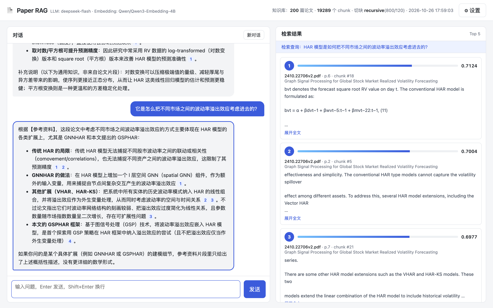

# Paper RAG 项目讲解：从零搭建论文知识库问答系统

> 本文档逐模块讲解项目的设计与实现，配有对应的代码片段。代码片段都摘自仓库中的实际代码，文件路径标在每段代码上方。
> 为了突出重点，部分片段做了删节（用 `...` 表示），个别片段补充了说明性注释，完整代码以仓库为准。
> 配套文档：《学生常见问题》（`docs/学生常见问题.md`）。

---

## 目录

1. [项目目标与最终效果](#1-项目目标与最终效果)
2. [整体架构与技术选型](#2-整体架构与技术选型)
3. [项目结构与配置](#3-项目结构与配置)
4. [课程数据集：Open RAG Benchmark](#4-课程数据集open-rag-benchmark)
5. [步骤 1：文档解析](#5-步骤-1文档解析-ragparserpy)
6. [步骤 2：文档切块](#6-步骤-2文档切块-ragchunkerpy)
7. [步骤 3：chunk 索引（Embedding + 向量库）](#7-步骤-3chunk-索引)
8. [步骤 4：知识检索](#8-步骤-4知识检索-ragretrieverpy)
9. [步骤 5：答案生成](#9-步骤-5答案生成-raggeneratorpy)
10. [把 5 步串起来：RAGPipeline](#10-把-5-步串起来ragpipelinepy)
11. [后端：FastAPI 与流式输出](#11-后端fastapi-与流式输出-apppy)
12. [前端：左右分栏界面](#12-前端左右分栏界面-static)
13. [检索评估：怎么知道 RAG 做得好不好](#13-检索评估scriptseval_retrievalpy)
14. [部署到服务器](#14-部署到服务器)
15. [实测数据汇总](#15-实测数据汇总)
16. [课堂练习与扩展方向](#16-课堂练习与扩展方向)

---

## 1. 项目目标与最终效果

**目标**：学生把论文 PDF 放进一个文件夹，就能在网页上用自然语言向这些论文提问，系统基于论文内容回答，并且能**看到答案依据的是哪些原文片段**。

**界面**（实际截图：第二轮追问「它是怎么……」被改写成了「HAR 模型是如何……」，显示在右侧顶部的「检索查询」里）：



- **左侧**：多轮对话，回答流式输出（逐字出现），句子后带 `[1]` `[2]` 这样的引用编号。
- **右侧**：本轮检索到的片段，包括**排名、相关性分数（余弦相似度）、来源论文与页码、片段原文**。
  - 点击回答里的引用编号，右侧会滚动到对应片段并高亮。
  - 点击历史中的某条回答，右侧会切换回那一轮的检索结果。

**RAG 的五个步骤**（也是本项目的代码组织方式）：

| 步骤 | 做什么 | 离线 / 在线 | 代码 |
|---|---|---|---|
| ① 文档解析 | PDF → 纯文本 | 离线 | `rag/parser.py` |
| ② 文档切块 | 长文本 → 若干 chunk | 离线 | `rag/chunker.py` |
| ③ chunk 索引 | chunk → 向量，写入向量库 | 离线 | `rag/embeddings.py`、`rag/indexer.py` |
| ④ 知识检索 | 问题 → 最相关的 Top-K chunk | 在线 | `rag/retriever.py` |
| ⑤ 答案生成 | 拼 prompt → 大模型生成回答 | 在线 | `rag/generator.py` |

---

## 2. 整体架构与技术选型

### 2.1 数据流

```
【离线】建索引：python ingest.py（只需做一次）
    papers/*.pdf
      → ① 解析：PyMuPDFLoader + 文本清洗
      → ② 切块：TextSplitter
      → ③ 向量化：Qwen3-Embedding（硅基流动 API）
      → 写入 Chroma 向量库（storage/chroma）

【在线】问答：python app.py（每次提问）
    用户问题
      → （第二轮起）DeepSeek 结合历史改写查询
      → ④ 检索：问题向量化，在 Chroma 中找 Top-K chunk     ⇒ 右侧面板
      → ⑤ 生成：系统指令 + 历史对话 + 参考资料 + 问题
         → DeepSeek 流式生成                              ⇒ 左侧对话
```

### 2.2 技术选型

| 环节 | 选型 | 为什么 |
|---|---|---|
| 框架 | **LangChain**（langchain-core 1.x） | 业界最常用的 RAG 框架，Loader / Splitter / VectorStore / Prompt / LLM 都有统一接口，学生学到的东西可迁移 |
| PDF 解析 | `PyMuPDFLoader`（底层 PyMuPDF） | 速度快、纯本地、对论文版式支持好 |
| 切块 | `CharacterTextSplitter` / `RecursiveCharacterTextSplitter` / `SemanticChunker` | 覆盖三种典型思路：固定长度、按结构递归、按语义 |
| Embedding | 硅基流动 `Qwen/Qwen3-Embedding-4B` API（通过 `OpenAIEmbeddings`） | 多语言（中文问英文论文）、效果好；走 API，学生电脑不需要 GPU、不用下载模型 |
| 向量库 | Chroma（`langchain-chroma`），本地持久化 | 零运维、装上即用，适合教学 |
| 大模型 | DeepSeek `deepseek-flash`（DeepSeek-V4.1-Flash，通过 `ChatDeepSeek`） | 便宜、快、中文好，支持思考模式 |
| 后端 | FastAPI + SSE 流式输出 | 代码少，原生支持流式响应 |
| 前端 | 原生 HTML / CSS / JS | 不需要 Node.js 和构建步骤，学生打开就能改 |

> **讲解提示**：可以先让学生思考，为什么要分成「离线」和「在线」两段？
> 答：解析、切块、向量化很慢（200 篇论文要十几分钟），只需要做一次；问答时只对**问题**做一次向量化，所以能在一两秒内返回。

---

## 3. 项目结构与配置

### 3.1 目录结构

```
├── papers/                       ← 论文 PDF 放在这里（也支持 .md / .txt）
├── config.py                     ← 所有可调参数（模型、路径、切块参数、Top-K……）
├── .env / .env.example           ← API Key 等私密配置（.env 不进版本库）
├── rag/
│   ├── parser.py                 ← ① 文档解析
│   ├── chunker.py                ← ② 文档切块
│   ├── embeddings.py             ← Embedding 模型
│   ├── indexer.py                ← ③ chunk 索引（向量化 + 写入 Chroma）
│   ├── retriever.py              ← ④ 知识检索
│   ├── generator.py              ← ⑤ 答案生成
│   └── pipeline.py               ← 把 5 步串起来
├── ingest.py                     ← 命令行建索引 / 预览切块效果
├── app.py                        ← FastAPI 后端
├── static/                       ← 前端（index.html / app.js / style.css）
├── scripts/
│   ├── download_open_ragbench.py ← 下载课程数据集
│   └── eval_retrieval.py         ← 段落级检索评估 / 切块方法对比
├── deploy/                       ← 部署用：锁定版本的依赖清单、systemd 服务文件
├── data/open_ragbench/           ← 下载脚本生成：问题、参考答案、标注
└── storage/                      ← 运行后生成：Chroma 向量库、索引信息
```

### 3.2 配置集中管理

所有参数集中在 `config.py`，优先从 `.env` 读取。学生调参时只改 `.env`，不用动代码。

`config.py`（节选）：

```python
ROOT = Path(__file__).resolve().parent
load_dotenv(ROOT / ".env")

# ---------- 大模型（DeepSeek） ----------
DEEPSEEK_API_KEY = os.getenv("DEEPSEEK_API_KEY", "")
DEEPSEEK_BASE_URL = os.getenv("DEEPSEEK_BASE_URL", "https://api.deepseek.com")
LLM_MODEL = os.getenv("LLM_MODEL", "deepseek-flash")  # DeepSeek-V4.1-Flash

# ---------- Embedding 模型（硅基流动 SiliconFlow，OpenAI 兼容接口） ----------
SILICONFLOW_API_KEY = os.getenv("SILICONFLOW_API_KEY", "")
SILICONFLOW_BASE_URL = os.getenv("SILICONFLOW_BASE_URL", "https://api.siliconflow.cn/v1")
EMBEDDING_MODEL = os.getenv("EMBEDDING_MODEL", "Qwen/Qwen3-Embedding-4B")
EMBEDDING_DIMENSIONS = int(os.getenv("EMBEDDING_DIMENSIONS") or 0) or None
EMBEDDING_BATCH_SIZE = int(os.getenv("EMBEDDING_BATCH_SIZE", "64"))  # 每次 API 请求包含的文本条数
QUERY_INSTRUCTION = os.getenv(
    "QUERY_INSTRUCTION",
    "Instruct: Given a question, retrieve relevant passages from academic papers that answer the question\nQuery: ",
)

# ---------- 切块默认参数 ----------
CHUNK_METHOD = os.getenv("CHUNK_METHOD", "recursive")  # fixed / recursive / semantic
CHUNK_SIZE = int(os.getenv("CHUNK_SIZE", "800"))  # 字符数
CHUNK_OVERLAP = int(os.getenv("CHUNK_OVERLAP", "120"))
SKIP_REFERENCES = os.getenv("SKIP_REFERENCES", "true").lower() == "true"

# ---------- 检索与生成 ----------
TOP_K = int(os.getenv("TOP_K", "5"))
MAX_HISTORY_TURNS = int(os.getenv("MAX_HISTORY_TURNS", "6"))  # 送进 LLM 的历史轮数

# ---------- Web 服务 ----------
HOST = os.getenv("HOST", "127.0.0.1")
PORT = int(os.getenv("PORT", "8000"))
READ_ONLY = os.getenv("READ_ONLY", "false").lower() == "true"
```

`.env.example`（发给学生的模板，复制成 `.env` 再填 Key）：

```ini
DEEPSEEK_API_KEY=sk-xxxxxxxx
DEEPSEEK_BASE_URL=https://api.deepseek.com
LLM_MODEL=deepseek-flash

SILICONFLOW_API_KEY=sk-xxxxxxxx
SILICONFLOW_BASE_URL=https://api.siliconflow.cn/v1
EMBEDDING_MODEL=Qwen/Qwen3-Embedding-4B
EMBEDDING_DIMENSIONS=

CHUNK_METHOD=recursive
CHUNK_SIZE=800
CHUNK_OVERLAP=120
TOP_K=5
PORT=8000
```

> **注意**：`.env` 里有 API Key，已写入 `.gitignore`，不要提交到代码仓库，也不要发到群里。

### 3.3 运行方式

```bash
pip install -r requirements.txt                 # 安装依赖（国内可加 -i https://mirrors.aliyun.com/pypi/simple/）
cp .env.example .env                            # 填入两个 API Key
python scripts/download_open_ragbench.py        # 下载课程数据集（默认 200 篇论文）
python ingest.py                                # 建索引（步骤 1~3）
python app.py                                   # 启动网页，浏览器打开 http://127.0.0.1:8000
```

---

## 4. 课程数据集：Open RAG Benchmark

### 4.1 为什么选它

课程使用 Vectara 发布的 [Open RAG Benchmark](https://huggingface.co/datasets/vectara/open_ragbench)，许可为 **CC BY-NC 4.0**（仅限非商业使用，使用时注明来源）：

- 1000 篇 arXiv 论文：396 篇**正样本**（是某些问题的答案来源）+ 604 篇**难负样本**（干扰文档）
- 3045 个问题，每个问题都标注了**答案所在的论文和段落**，并给出参考答案
- 约 1/3 的问题需要看论文中的图片或表格才能回答，可以用来引出「多模态 RAG」这个话题

带标注的数据集意味着我们不仅能演示 RAG，还能**量化评估** RAG（见第 13 节）。

### 4.2 数据集的文件

```
qrels.json     {问题id: {"doc_id": "2406.17374v2", "section_id": 7}}   ← 答案在哪篇论文的第几段
queries.json   {问题id: {"query": "...", "type": "extractive", "source": "text"}}
answers.json   {问题id: "参考答案"}
pdf_urls.json  {"2406.17374v2": "https://arxiv.org/pdf/2406.17374v2"}   ← 数据集本身不含 PDF
```

### 4.3 下载脚本 `scripts/download_open_ragbench.py`

数据集只提供 PDF 链接，需要从 arXiv 逐篇下载。关键设计：

1. **固定随机种子**：每个学生下载到的子集都一样，课堂上讨论同一个问题时结果可以对得上
2. **限速**：arXiv 要求脚本批量访问走 `export.arxiv.org`，并且每 3 秒最多 1 个请求
3. **可续传**：已下载的文件会跳过；写到 `.part` 临时文件后再改名，中断时不会留下半个 PDF
4. **重试**：网络抖动时自动重试

`scripts/download_open_ragbench.py`（节选）：

```python
def select_papers(meta: dict, n_pos: int, n_neg: int, seed: int) -> list[str]:
    positives = sorted({q["doc_id"] for q in meta["qrels"].values()})
    negatives = sorted(set(meta["pdf_urls"]) - set(positives))
    rng = random.Random(seed)  # 固定随机种子，保证每个学生拿到的子集相同
    return rng.sample(positives, min(n_pos, len(positives))) + rng.sample(negatives, min(n_neg, len(negatives)))


def download_pdf(url: str, path: Path, retries: int = 3) -> bool:
    # arXiv 建议程序化访问走 export.arxiv.org
    url = url.replace("://arxiv.org/", "://export.arxiv.org/")
    for attempt in range(1, retries + 1):
        try:
            data = fetch(url)
            if not data.startswith(b"%PDF"):
                raise ValueError("返回内容不是 PDF")
            tmp = path.with_suffix(".part")
            tmp.write_bytes(data)
            tmp.rename(path)  # 写完再改名，中断时不会留下损坏的 PDF
            return True
        except Exception as e:
            print(f"    第 {attempt} 次失败: {e}")
            time.sleep(10 * attempt)
    return False
```

用法：

```bash
python scripts/download_open_ragbench.py                                   # 默认 200 篇：100 正 + 100 负
python scripts/download_open_ragbench.py --positives 20 --negatives 20     # 课堂小样本
python scripts/download_open_ragbench.py --positives 396 --negatives 604   # 全量 1000 篇
```

下载完成后会生成 `data/open_ragbench/eval_queries.json`，列出已下载论文对应的问题和参考答案，可以直接复制到网页里提问。

---

## 5. 步骤 1：文档解析 `rag/parser.py`

### 5.1 LangChain 的 Document

LangChain 里所有文本都用 `Document` 表示，后面的切块、向量库、检索都围绕它展开：

```python
Document(page_content="正文文本……", metadata={"source": "xxx.pdf", "page": 3, "title": "..."})
```

### 5.2 用 PyMuPDFLoader 按页读取

```python
def load_pdf(path: Path, skip_references: bool = True) -> list[Document]:
    # mode="page"：每页一个 Document，metadata 里自带页码 page（从 0 开始）；sort=True 按阅读顺序排列文本
    pages = PyMuPDFLoader(str(path), mode="page", sort=True).load()
    title = (pages[0].metadata.get("title") or "").strip() if pages else ""

    docs = []
    for page in pages:
        text = page.page_content
        ref = _REFERENCES_RE.search(text) if skip_references else None
        if ref:
            text = text[: ref.start()]
        text = clean_text(text)
        if text:
            docs.append(Document(page_content=text, metadata={"page": page.metadata["page"] + 1}))
        if ref:
            break

    # PDF 元数据里的标题经常为空或是无意义的内容，退而求其次从第一页版面里猜
    if len(title) < 8 or title.lower().startswith(("microsoft word", "untitled")):
        title = guess_title(path) or path.stem
    for d in docs:
        d.metadata.update(source=path.name, title=title)
    return docs
```

`sort=True` 很重要：论文多是双栏排版，不排序时文本可能是左栏一行、右栏一行交错出现的。

### 5.3 文本清洗：论文 PDF 的三个常见问题

PDF 只记录「字符画在哪里」，没有段落的概念，直接抽出的文字会有排版痕迹：

```
原始：Retrieval-augmented generation combines a retrie-
      ver with a generator. We show that it out-
      performs ...
```

```python
def clean_text(text: str) -> str:
    text = re.sub(r"(\w)-\n(\w)", r"\1\2", text)  # 行尾连字符断词
    # 句末标点后的换行视为段落边界（保留，供递归切分使用），其余换行是排版造成的，替换为空格
    text = re.sub(r"(?<=[.!?。！？:：])[ \t]*\n\s*", "\n\n", text)
    text = re.sub(r"(?<!\n)\n(?!\n)", " ", text)
    text = re.sub(r"[ \t]{2,}", " ", text)
    return text.strip()
```

| 问题 | 处理 |
|---|---|
| 行尾连字符断词 `retrie-\nver` | 合并为 `retriever` |
| 段内硬换行（每行都有 `\n`） | 替换为空格 |
| 段落边界丢失 | 句末标点后的换行视为段落边界，转成 `\n\n`（后面递归切分会优先在这里切） |

### 5.4 丢弃参考文献

参考文献里全是人名、期刊名和年份，和问题的关键词经常「撞车」，会被错误地检索出来。遇到单独成行的 References 标题，就丢弃之后的内容：

```python
# 单独成行的「参考文献」标题，遇到它之后的内容全部丢弃
_REFERENCES_RE = re.compile(r"^\s*(\d+\.?\s*)?(references|bibliography|参考文献)\s*$", re.I | re.M)
```

> **讲解提示（这是一个有意保留的缺陷）**：这样做会把参考文献**之后的附录**也一起丢掉。第 13 节的评估会定量地揭示这个问题：约 12% 的问题答案在附录里，因此永远检索不到。可以让学生自己发现并改进它。

### 5.5 猜论文标题

在 200 篇论文里，只有 22 篇的 PDF 元数据里有标题。如果直接取第一页第一行，会得到 `"1"` 或者 arXiv 的竖排水印 `arXiv:2401.03328v2 [econ.TH] 10 Dec 2024`。改进办法：**标题通常是第一页字号最大的横排文字**。

```python
def guess_title(path: Path) -> str:
    with pymupdf.open(path) as pdf:
        if not len(pdf):
            return ""
        # 以「行」为单位统计字号（取行内最大字号），这样小型大写字母（首字母更大）的标题不会被拆散
        lines = []
        for block in pdf[0].get_text("dict")["blocks"]:
            for line in block.get("lines", []):
                text = "".join(span["text"] for span in line["spans"]).strip()
                if abs(line["dir"][1]) < 0.01 and len(text) >= 2 and not text.lower().startswith("arxiv"):
                    lines.append((round(max(span["size"] for span in line["spans"]), 1), text))
    # 从大到小尝试各个字号，取第一个「像标题」的：字母够多（排除公式符号），又不太长（排除正文）
    candidates = []
    for size in sorted({s for s, _ in lines}, reverse=True):
        text = re.sub(r"\s+", " ", " ".join(t for s, t in lines if s == size))
        if len(re.findall(r"[A-Za-z一-鿿]", text)) >= 15:
            if len(text) <= 300:
                return text
            candidates.append(text)
    return candidates[0][:150] if candidates else ""
```

这里依次处理了三个坑：

1. `line["dir"]` 是文字方向向量，`dir[1] ≠ 0` 表示非横排。用它排除 arXiv 的竖排水印。
2. 有些标题用小型大写字母排版，首字母字号更大。按 span 统计会把一个词拆散（`T`+`RANSFORMERS`），所以要按「行」统计。
3. 最大字号可能是公式符号或正文，所以要求字母数 ≥ 15、长度 ≤ 300。

> 这是一个启发式方法，少数特殊排版的论文仍然会猜错，但只影响界面上的显示，不影响检索。

### 5.6 容错

个别 PDF 损坏或格式特殊时跳过，不让一篇论文的问题中断整个建索引过程：

```python
try:
    pages = load_pdf(path, skip_references) if path.suffix.lower() == ".pdf" else load_text(path)
except Exception as e:  # 个别 PDF 损坏或格式特殊时跳过，不影响其他论文
    print(f"      ! 解析失败，已跳过 {path.name}: {e}")
    continue
```

---

## 6. 步骤 2：文档切块 `rag/chunker.py`

### 6.1 为什么要切块

- Embedding 模型的输入长度有限，而且**一段文字越长，向量越「平均」**，越难精确匹配具体问题
- 送进大模型的参考资料越长，token 成本越高，模型也更容易被无关内容干扰
- 切块的目标：**每个 chunk 语义完整、主题单一、长度适中**

### 6.2 核心设计：整篇切分 + 起始位置反查页码

逐页切分的话，跨页的段落会被硬切成两半。所以先把整篇论文拼成一个长字符串，切完以后，再根据每个 chunk 在全文中的**起始位置**反查页码：

```python
def chunk_paper(pages, method, chunk_size, chunk_overlap, embeddings=None) -> list[Document]:
    full_text, page_starts, page_nos = "", [], []
    for page in pages:
        if full_text:
            full_text += PAGE_SEP
        page_starts.append(len(full_text))   # 记录每页在全文中的起始位置
        page_nos.append(page.metadata["page"])
        full_text += page.page_content

    def page_of(offset: int) -> int:          # 二分查找：offset 落在哪一页
        return page_nos[max(0, bisect.bisect_right(page_starts, offset) - 1)]
    ...
            Document(
                id=f"{source}::{idx}",
                page_content=text,
                metadata={
                    "source": source,
                    "title": title,
                    "page_start": page_of(start),
                    "page_end": page_of(start + len(text) - 1),
                    "chunk_index": idx,
                    "method": method,
                },
            )
```

LangChain 的 splitter 设置 `add_start_index=True` 后，会在每个 chunk 的 metadata 里记录 `start_index`，正好用来反查页码。

### 6.3 三种切块方法

```python
def split_text(text, method, chunk_size, chunk_overlap, embeddings):
    """返回 [(chunk 文本, 在 text 中的起始位置)]。"""
    if method == "fixed":
        splitter = CharacterTextSplitter(
            separator="", chunk_size=chunk_size, chunk_overlap=chunk_overlap, add_start_index=True
        )
        return [(d.page_content, d.metadata["start_index"]) for d in splitter.create_documents([text])]

    if method == "recursive":
        splitter = recursive_splitter(chunk_size, chunk_overlap)
        return [(d.page_content, d.metadata["start_index"]) for d in splitter.create_documents([text])]

    if method == "semantic":
        ...
```

**① fixed：固定长度滑动窗口**

`separator=""` 表示不找分隔符，按字符数硬切。实际效果是会把单词拦腰截断：

```
--- #0  400 字符 ---
... a dense vector index of Wikipedia accessed with a neural retriever. On open-domain question answering, RAG sets
--- #1  400 字符 ---
eural retriever. On open-domain question answering, RAG sets a new state of the art ...
```

**② recursive：递归字符切分（默认）**

按分隔符的优先级依次尝试：先按段落切，块还太长就按换行切，再按句子切，最后才按空格切：

```python
# 递归切分时依次尝试的分隔符（中英文都考虑）
RECURSIVE_SEPARATORS = ["\n\n", "\n", ". ", "。", "! ", "? ", "！", "？", "; ", "；", ", ", "，", " ", ""]

def recursive_splitter(chunk_size: int, chunk_overlap: int) -> RecursiveCharacterTextSplitter:
    return RecursiveCharacterTextSplitter(
        separators=RECURSIVE_SEPARATORS,
        chunk_size=chunk_size,
        chunk_overlap=chunk_overlap,
        keep_separator="end",  # 句号等分隔符留在前一块的末尾
        add_start_index=True,  # 在 metadata 里记录 chunk 在原文中的起始位置
    )
```

**③ semantic：语义切分**

把文本分成句子，计算相邻句子 embedding 的距离，在距离突然变大（话题切换）的地方断开：

```python
    if method == "semantic":
        splitter = SemanticChunker(
            embeddings,
            breakpoint_threshold_type="percentile",  # 相邻句子距离超过第 90 百分位处断开
            breakpoint_threshold_amount=90,
            sentence_split_regex=SENTENCE_SPLIT_REGEX,
        )
        # SemanticChunker 不限制块的大小，过长的块再用递归切分兜底
        fallback = recursive_splitter(chunk_size, chunk_overlap)
        pieces = []
        for chunk in splitter.split_text(text):
            pieces.extend([chunk] if len(chunk) <= chunk_size * 1.5 else fallback.split_text(chunk))
        # SemanticChunker 会用空格重新拼接句子，没有准确的 start_index，所以用开头片段在原文里定位
        results, cursor = [], 0
        for piece in pieces:
            found = text.find(piece[:30], cursor)
            cursor = cursor if found == -1 else found
            results.append((piece, cursor))
        return results
```

| 方法 | 优点 | 缺点 |
|---|---|---|
| `fixed` | 最简单，块大小均匀 | 会截断句子甚至单词 |
| `recursive` | 尽量保持段落、句子完整 | 块大小不完全均匀 |
| `semantic` | 按话题切分 | 每个句子都要调用 embedding API，建索引慢、有费用；块大小不受控 |

### 6.4 两个容易忽略的细节

**细节 1：递归切分会把短标题切成单独一块**

当「短标题 + 超长段落」相邻时，比如 `Abstract\n\n` 后面跟着一个 465 字符的段落（chunk_size=400），段落本身太长，要继续往下切，标题 `Abstract` 就会被单独留成一块。如果简单丢弃过短的块，章节标题就丢了。做法是把短碎片拼到下一块的开头：

```python
    pending = None  # 过短的碎片（例如单独一行的章节标题 "Abstract"）先暂存，拼到下一块的开头
    for text, start in split_text(full_text, method, chunk_size, chunk_overlap, embeddings):
        text = text.strip()
        if pending:
            text, start = pending[0] + "\n\n" + text, pending[1]
            pending = None
        if len(text) < MIN_CHUNK_CHARS:
            pending = (text, start)
            continue
        ...
    if pending and chunks:  # 末尾剩下的碎片并入最后一块
        chunks[-1].page_content += "\n\n" + pending[0]
```

**细节 2：chunk_overlap 的作用**

相邻块之间保留一段重叠的文字，避免一句关键的话正好被切在两块的边界上。overlap 越大，冗余越多，索引也越大。通常设为 chunk_size 的 10%～20%。

### 6.5 课堂演示：直观对比切块效果

```bash
python ingest.py --inspect --method fixed --size 400 --overlap 60
python ingest.py --inspect --method recursive --size 400 --overlap 60
python ingest.py --inspect --method semantic --size 400
```

`--inspect` 只做解析和切块，打印每篇论文的前几个 chunk（包括页码和长度），不写入向量库。

---

## 7. 步骤 3：chunk 索引

### 7.1 Embedding：把文字变成向量

Embedding 模型把一段文字映射成一个高维向量（Qwen3-Embedding-4B 是 2560 维）。语义相近的文字，向量方向也相近，可以用**余弦相似度**衡量：

```
cos(a, b) = (a · b) / (|a| |b|)     取值 -1 ~ 1，越大越相似
```

### 7.2 用 OpenAIEmbeddings 对接硅基流动 `rag/embeddings.py`

硅基流动的接口和 OpenAI 兼容，所以直接用 LangChain 的 `OpenAIEmbeddings`，改一下 `base_url` 就行：

```python
class InstructedEmbeddings(OpenAIEmbeddings):
    """在 query 前加任务指令（Qwen3-Embedding 的推荐用法），文档向量化时不加。"""

    query_instruction: str = ""

    def embed_query(self, text: str) -> list[float]:
        return super().embed_query(self.query_instruction + text)

    async def aembed_query(self, text: str) -> list[float]:
        return await super().aembed_query(self.query_instruction + text)


def get_embeddings() -> InstructedEmbeddings:
    if not config.SILICONFLOW_API_KEY:
        raise RuntimeError("未设置 SILICONFLOW_API_KEY，请在 .env 中配置")
    return InstructedEmbeddings(
        model=config.EMBEDDING_MODEL,
        base_url=config.SILICONFLOW_BASE_URL,
        api_key=config.SILICONFLOW_API_KEY,
        dimensions=config.EMBEDDING_DIMENSIONS,
        chunk_size=config.EMBEDDING_BATCH_SIZE,  # 注意：这里的 chunk_size 指每次请求的文本条数，不是切块大小
        # 必须关掉：否则会先用 OpenAI 的 tiktoken 把文本转成 token id 再发送，非 OpenAI 服务不认
        check_embedding_ctx_length=False,
        query_instruction=config.QUERY_INSTRUCTION,
    )
```

三个要点：

**① `check_embedding_ctx_length=False`，最重要的一个坑**

默认值 `True` 时，LangChain 会先用 OpenAI 的分词器 tiktoken，把文本转成 **token id 数组**再发送。我们实测过：硅基流动**不会报错**，但返回的向量是错的。同一句话用两种方式得到的向量，余弦相似度只有约 0.3，而且不同句子之间的相似度也区分不开。结果是**程序完全正常运行，但检索结果全是不相关的内容**，非常难排查。

**② Query 指令（非对称检索）**

Qwen3-Embedding 官方建议：**问题前加任务描述，文档不加**。问题通常很短、是疑问句，文档段落很长、是陈述句，两者的表达方式不同，加指令能帮模型把问题映射到「答案所在段落」的向量空间。所以写了一个子类，只重写 `embed_query`。

**③ `chunk_size` 这个名字有歧义**

`OpenAIEmbeddings` 的 `chunk_size` 指的是**每次 API 请求包含多少条文本**（批大小），和切块的 chunk_size 无关。

### 7.3 向量库 Chroma `rag/indexer.py`

```python
def get_vectorstore(embeddings, collection_name=config.COLLECTION_NAME, persist_dir=config.CHROMA_DIR) -> Chroma:
    """LangChain 的 Chroma 向量库：本地持久化，embedding_function 负责把文本转成向量。"""
    persist_dir.mkdir(parents=True, exist_ok=True)
    return Chroma(
        collection_name=collection_name,
        embedding_function=embeddings,
        persist_directory=str(persist_dir),
        # 用余弦距离（默认是 L2）；这样检索得到的相关性分数 = 1 - 余弦距离 = 余弦相似度
        collection_configuration={"hnsw": {"space": "cosine"}},
        client_settings=Settings(anonymized_telemetry=False, is_persistent=True),
    )
```

- `persist_directory`：向量库保存在 `storage/chroma/` 目录下，重启程序后数据还在
- `collection_configuration={"hnsw": {"space": "cosine"}}`：距离度量设为余弦距离。Chroma 默认用 L2（欧氏距离），那样算出的分数不直观
- HNSW 是 Chroma 使用的**近似最近邻**索引结构，不用逐一比较所有向量，所以检索很快

### 7.4 建索引的完整流程

```python
def build_index(vectorstore, embeddings, method=..., chunk_size=..., chunk_overlap=..., skip_references=..., log=print):
    """完整的离线流程：解析 -> 切块 -> 向量化 -> 入库。返回本次索引的统计信息。"""
    papers = load_papers(config.PAPERS_DIR, skip_references)                       # ① 解析
    chunks = []
    for pages in papers.values():
        chunks.extend(chunk_paper(pages, method, chunk_size, chunk_overlap, embeddings))   # ② 切块

    vectorstore.reset_collection()  # 清空旧索引
    batch = 64
    for i in range(0, len(chunks), batch):
        # add_documents 内部会调用 embeddings.embed_documents 计算向量，再写入 Chroma    # ③ 向量化 + 入库
        vectorstore.add_documents(chunks[i : i + batch], ids=[c.id for c in chunks[i : i + batch]])
        log(f"      {min(i + batch, len(chunks))}/{len(chunks)}")

    info = {"chunk_method": method, "embedding_model": config.EMBEDDING_MODEL, "num_chunks": len(chunks), ...}
    config.INDEX_INFO_FILE.write_text(json.dumps(info, ensure_ascii=False, indent=2), encoding="utf-8")
```

- **分批写入**：一方面能打印进度（200 篇论文约 1.9 万个 chunk，要十几分钟）；另一方面单次请求不会太大
- **记录 `index_info.json`**：保存本次用的切块方法、embedding 模型等信息。检索时会核对，换了模型却没有重建索引时，能给出明确的提示（见第 8 节）
- **chunk id 用 `文件名::序号`**：便于定位，前端也会显示 chunk 序号

命令行建索引：

```bash
python ingest.py                                       # 默认参数
python ingest.py --method fixed --size 500 --overlap 50
python ingest.py --keep-references                     # 保留参考文献
```

---

## 8. 步骤 4：知识检索 `rag/retriever.py`

### 8.1 带分数的相似度检索

```python
class Retriever:
    def retrieve(self, query: str, top_k: int = 5) -> list[RetrievedChunk]:
        if self.vectorstore._collection.count() == 0:
            return []
        info = load_index_info()
        if info and info["embedding_model"] != config.EMBEDDING_MODEL:
            raise RuntimeError(
                f"索引由 {info['embedding_model']} 构建，当前模型是 {config.EMBEDDING_MODEL}，请重建索引"
            )
        # 常见写法是 vectorstore.as_retriever(search_kwargs={"k": top_k})，但它不返回分数；
        # 这里要在前端展示相关性分数，所以直接调用带分数的检索方法
        results = self.vectorstore.similarity_search_with_relevance_scores(query, k=top_k)
        return [
            RetrievedChunk(rank=i + 1, score=round(score, 4), chunk_id=doc.id, text=doc.page_content,
                           source=doc.metadata["source"], title=doc.metadata["title"],
                           page_start=doc.metadata["page_start"], page_end=doc.metadata["page_end"])
            for i, (doc, score) in enumerate(results)
        ]
```

检索过程：问题 → `embed_query`（加上任务指令）→ 在 Chroma 中找余弦距离最小的 K 个向量 → 分数 = 1 − 余弦距离 = **余弦相似度**。

> **关于分数**：实测中相关片段的分数通常在 0.5～0.75 之间，不会接近 1。分数的绝对值意义不大，**排名才是关键**。不同 embedding 模型的分数分布也不同，不要用一个固定阈值去套所有模型。

### 8.2 多轮对话的查询改写

第二轮起，用户经常这样问：「它在 NQ 上的分数是多少？」直接拿这句话去检索，「它」指什么，向量库是不知道的。所以先让大模型结合对话历史，把问题改写成独立、完整的查询：

```
对话历史：user: RAG 论文在哪些数据集上做了实验？  assistant: 在 NQ、TriviaQA……
最新问题：它在 NQ 上的分数是多少？
改写结果：RAG 论文在 NQ 数据集上的分数是多少？    ← 实测输出
```

改写在 `generator.py` 中实现（见 9.3），改写后的查询显示在右侧面板顶部，学生可以直接看到检索实际用了什么。设置里可以关闭改写，对比检索效果的差异。

---

## 9. 步骤 5：答案生成 `rag/generator.py`

### 9.1 Prompt 设计

```python
SYSTEM_PROMPT = """你是一个学术论文问答助手，负责根据用户本地论文库中检索到的片段回答问题。

规则：
1. 优先依据【参考资料】作答，并在相应句子后用 [编号] 标注出处，例如 "……提升了召回率 [2]"。
2. 如果参考资料不足以回答，请明确说明"在已有论文中没有找到相关信息"，可以补充你的通用知识，但必须注明那部分不是来自论文。
3. 用户用什么语言提问就用什么语言回答；论文术语可保留英文原文。
4. 回答条理清晰，必要时使用 Markdown 列表或表格。"""

# 问答 prompt：系统指令 + 历史对话 + 本轮（参考资料 + 问题）
ANSWER_PROMPT = ChatPromptTemplate.from_messages(
    [
        ("system", SYSTEM_PROMPT),
        MessagesPlaceholder("history"),
        ("human", "【参考资料】\n{context}\n\n【问题】\n{question}"),
    ]
)
```

参考资料带编号和出处，模型回答时就能引用编号：

```python
def format_context(chunks: list[RetrievedChunk]) -> str:
    parts = []
    for c in chunks:
        pages = f"p.{c.page_start}" if c.page_start == c.page_end else f"p.{c.page_start}-{c.page_end}"
        parts.append(f"[{c.rank}] 来源：{c.source}（{pages}）\n{c.text}")
    return "\n\n".join(parts) if parts else "（知识库中没有检索到相关内容）"
```

最终发给模型的内容大致是：

```
[system] 你是一个学术论文问答助手……规则 1~4
[human]  RAG 论文在哪些数据集上做了实验？          ← 历史（纯文本）
[ai]     在 NQ、TriviaQA……
[human]  【参考资料】
         [1] 来源：xxx.pdf（p.3）
         4 Experiments  We use a single Wikipedia dump ...
         [2] 来源：……
         【问题】
         它在 NQ 上的分数是多少？
```

设计要点：

- **规则 2 用来防止幻觉**：资料不足时必须说明，补充的通用知识必须标注。实测中模型会写「补充说明（非论文内容）：……」
- **历史只保留纯文本问答**，不重复附带每一轮的参考资料，否则 token 数会随轮数快速增长
- **只保留最近 `MAX_HISTORY_TURNS` 轮**（默认 6 轮）

### 9.2 LCEL 链与流式输出

LangChain 用 `|` 把组件串成链（LCEL，LangChain Expression Language）：`prompt | 模型 | 输出解析器`。

```python
class Generator:
    def __init__(self):
        self.llm = ChatDeepSeek(
            model=config.LLM_MODEL, api_key=config.DEEPSEEK_API_KEY, base_url=config.DEEPSEEK_BASE_URL
        )
        # LCEL：prompt | 模型 | 输出解析器。查询改写是简单任务，关闭思考、温度设为 0
        self.rewrite_chain = (
            REWRITE_PROMPT | self.llm.bind(temperature=0, extra_body=thinking(False)) | StrOutputParser()
        )

    def stream_answer(self, history, question, chunks, enable_thinking=False):
        chain = ANSWER_PROMPT | self.llm.bind(extra_body=thinking(enable_thinking))
        inputs = {
            "history": history[-config.MAX_HISTORY_TURNS * 2 :],  # [{"role": ..., "content": ...}] 可直接作为消息
            "context": format_context(chunks),
            "question": question,
        }
        for chunk in chain.stream(inputs):
            # ChatDeepSeek 把思考过程放在 additional_kwargs["reasoning_content"] 里
            reasoning = chunk.additional_kwargs.get("reasoning_content")
            if reasoning:
                yield "reasoning", reasoning
            if chunk.content:
                yield "content", chunk.content
```

- `.bind(...)` 给模型绑定调用参数，得到一个新的 Runnable，原对象不变
- `chain.stream()` 逐块返回 `AIMessageChunk`，我们把它转成 `("reasoning", 文本)` / `("content", 文本)` 事件，交给后端推送给前端

### 9.3 DeepSeek 的思考模式

```python
def thinking(enabled: bool) -> dict:
    """DeepSeek 的思考模式开关，通过 extra_body 透传给 API。"""
    return {"thinking": {"type": "enabled" if enabled else "disabled"}}
```

- **查询改写**：关闭思考，这种简单任务开思考只会更慢
- **回答**：由界面上的「深度思考」开关控制。开启后，思考过程会显示在回答上方的折叠区域，可以展开查看

查询改写：

```python
REWRITE_PROMPT = ChatPromptTemplate.from_messages([
    ("system", """你的任务是把多轮对话中用户的最新问题改写成一个「独立、完整、适合做向量检索」的查询语句。
- 补全代词和省略的指代（例如 "它的实验结果呢" -> "XXX 方法的实验结果"）
- 保留论文中的专有名词和英文术语
- 如果最新问题本身已经完整，原样输出
只输出改写后的查询，不要任何解释。"""),
    ("human", "对话历史：\n{dialog}\n\n最新问题：{question}"),
])

def rewrite_query(self, history: list[dict], question: str) -> str:
    """多轮对话中的查询改写：没有历史时直接返回原问题。"""
    if not history:
        return question
    dialog = "\n".join(f"{m['role']}: {m['content'][:500]}" for m in history[-6:])
    return self.rewrite_chain.invoke({"dialog": dialog, "question": question}).strip() or question
```

历史对话被格式化成**一段文本**放进 prompt，而不是作为多轮消息传入，这样模型不会误以为自己在继续对话，转而去回答问题。

---

## 10. 把 5 步串起来：`rag/pipeline.py`

```python
class RAGPipeline:
    def __init__(self):
        self.embeddings = get_embeddings()
        self.vectorstore = get_vectorstore(self.embeddings)
        self.retriever = Retriever(self.vectorstore)
        self.generator = Generator()

    # ---------- 离线：步骤 1~3 ----------
    def build_index(self, **kwargs) -> dict:
        return build_index(self.vectorstore, self.embeddings, **kwargs)

    # ---------- 在线：步骤 4~5 ----------
    def chat(self, history, question, top_k=config.TOP_K, rewrite=True, thinking=False):
        """一次完整的问答，按顺序产出事件，方便前端实时展示每一步：
        ("query", 检索用的查询) -> ("chunks", 检索结果) -> ("reasoning"/"content", 文本片段)...
        """
        query = self.generator.rewrite_query(history, question) if rewrite else question
        yield "query", query

        chunks = self.retriever.retrieve(query, top_k)
        yield "chunks", [asdict(c) for c in chunks]

        yield from self.generator.stream_answer(history, question, chunks, thinking)
```

`chat` 是一个**生成器**：每完成一步就 `yield` 一个事件。这样前端可以先看到检索结果，再看到逐字生成的回答，学生能直观感受到 RAG 的每一步。

注意第 3 步用的是**改写后的 query** 去检索，而生成时用的是**原问题** `question` 加上历史。原因是：检索需要独立完整的句子，而回答要贴合用户的原话和对话语境。

---

## 11. 后端：FastAPI 与流式输出 `app.py`

### 11.1 接口一览

| 接口 | 说明 |
|---|---|
| `GET  /` | 返回前端页面 |
| `GET  /api/status` | 模型、论文文件、索引信息、是否只读 |
| `POST /api/index` | 重建索引 `{"method": "recursive", "chunk_size": 800, "chunk_overlap": 120}` |
| `POST /api/search` | 只检索、不生成，便于单独调试检索效果 |
| `POST /api/chat` | 检索 + 流式生成（SSE） |

### 11.2 SSE 流式输出

SSE（Server-Sent Events）是 HTTP 上的单向推送协议，每个事件的格式是：

```
event: chunks
data: [{"rank": 1, "score": 0.6274, ...}]

event: content
data: "RAG-Sequence"

```

```python
def sse(event: str, data) -> str:
    return f"event: {event}\ndata: {json.dumps(data, ensure_ascii=False)}\n\n"


@app.post("/api/chat")
def chat(req: ChatRequest):
    if not req.messages or req.messages[-1].role != "user":
        raise HTTPException(400, "最后一条消息必须来自 user")
    history = [m.model_dump() for m in req.messages[:-1]]
    question = req.messages[-1].content

    def event_stream():
        try:
            for kind, data in pipeline.chat(history, question, req.top_k, req.rewrite, req.thinking):
                yield sse(kind, data)
            yield sse("done", {})
        except Exception as e:  # 把错误也推给前端显示
            yield sse("error", {"message": f"{type(e).__name__}: {e}"})

    # Server-Sent Events：先推送检索结果，再逐字推送回答
    return StreamingResponse(event_stream(), media_type="text/event-stream")
```

- 每次请求时，前端把**完整对话**（只含纯文本）发给后端，后端本身不保存会话状态，实现简单，重启也不会丢失对话
- 出错时也通过 SSE 推送 `error` 事件，前端会把错误直接显示在对话框里，方便学生排查

### 11.3 重建索引的保护

```python
index_lock = threading.Lock()  # 防止重复点击「重建索引」

@app.post("/api/index")
def rebuild_index(req: IndexRequest):
    # 普通 def 路由由 FastAPI 放到线程池执行，不会阻塞其他请求
    if config.READ_ONLY:
        raise HTTPException(403, "只读模式下不能重建索引")
    if not index_lock.acquire(blocking=False):
        raise HTTPException(409, "索引正在构建中，请稍候")
    try:
        return pipeline.build_index(method=req.method, chunk_size=req.chunk_size, chunk_overlap=req.chunk_overlap)
    finally:
        index_lock.release()
```

- **锁**：防止重复点击「重建索引」，导致两个建索引过程同时写同一个向量库
- **只读模式**：公网部署时禁止访客触发重建，避免消耗 embedding 额度

---

## 12. 前端：左右分栏界面 `static/`

前端由三个文件组成，不依赖任何框架：`index.html`（结构）、`style.css`（样式）、`app.js`（逻辑）。

### 12.1 读取 SSE 流

浏览器自带的 `EventSource` 只支持 GET 请求，而我们要用 POST 发送对话内容，所以用 `fetch` 读取响应流，自己解析事件：

```javascript
// 解析 Server-Sent Events：每个事件形如 "event: xxx\ndata: {...}\n\n"
async function* readSSE(response) {
  const reader = response.body.getReader();
  const decoder = new TextDecoder();
  let buf = "";
  while (true) {
    const { value, done } = await reader.read();
    if (done) break;
    buf += decoder.decode(value, { stream: true });
    let pos;
    while ((pos = buf.indexOf("\n\n")) >= 0) {
      const raw = buf.slice(0, pos);
      buf = buf.slice(pos + 2);
      let event = "message", data = "";
      for (const line of raw.split("\n")) {
        if (line.startsWith("event:")) event = line.slice(6).trim();
        else if (line.startsWith("data:")) data += line.slice(5).trim();
      }
      yield { event, data: data ? JSON.parse(data) : null };
    }
  }
}
```

注意 `buf` 缓冲：网络传输的一个数据包可能只有半个事件，所以要攒到 `\n\n` 再解析。

### 12.2 按事件更新界面

```javascript
    for await (const { event, data } of readSSE(res)) {
      if (event === "query") {
        reply.query = data;                 // 右侧顶部显示「检索查询」
      } else if (event === "chunks") {
        reply.chunks = data;
        renderChunks(reply);                // 右侧渲染检索结果卡片
      } else if (event === "reasoning") {
        reply.reasoning += data;            // 思考过程（折叠显示）
      } else if (event === "content") {
        reply.content += data;              // 回答逐字追加
      } else if (event === "error") {
        reply.error = data.message;
      }
      updateLast();                         // 只重绘最后一条消息，避免整页闪烁
    }
```

每条助手消息都保存了自己那一轮的 `chunks`，所以点击历史回答，就能在右侧切换回那一轮的检索结果。

### 12.3 引用编号变成可点击的标签

```javascript
// CommonMark 规定 ** 紧挨中文标点时不算加粗（例如 **溢出效应（spillover）**），这里先手动转成 <strong>；
// 代码块和行内代码里的 ** 保持原样（split 的捕获组让奇数下标正好是代码部分）
function fixCjkBold(text) {
  return text
    .split(/(```[\s\S]*?```|`[^`\n]*`)/)
    .map((part, i) => (i % 2 ? part : part.replace(/\*\*([^*\n]+?)\*\*/g, "<strong>$1</strong>")))
    .join("");
}

// Markdown 渲染；把 [1]、[2,3] 这样的引用变成可点击的小标签
function renderMarkdown(text) {
  let html = window.marked && window.DOMPurify
    ? DOMPurify.sanitize(marked.parse(fixCjkBold(text)))
    : escapeHtml(text).replace(/\n/g, "<br>");
  return html.replace(/\[(\d+(?:\s*[,，]\s*\d+)*)\]/g, (_, nums) =>
    nums.split(/[,，]/).map((n) => `<span class="cite" data-n="${n.trim()}">${n.trim()}</span>`).join("")
  );
}
```

- **Markdown 渲染**：用 `marked` 把 Markdown 转成 HTML，再用 `DOMPurify` 过滤。模型输出的内容不可信，要防止 XSS
- **中文加粗的坑**：按 CommonMark 规范，`**` 紧挨着中文全角标点时（例如 `**溢出效应（spillover）**`）不会被识别为加粗，页面上会露出 `**`。所以渲染前先用 `fixCjkBold` 把这类加粗手动转成 `<strong>`
- **降级**：两个库从 CDN 加载，CDN 不可用时退化为纯文本显示，页面不会因此坏掉
- **点击引用**：点击引用标签后，调用 `focusChunk(n)`，右侧滚动到第 n 个片段并闪烁高亮

### 12.4 检索结果卡片

每张卡片包含四部分：排名圆标、分数条（宽度 = 分数 × 100%）、来源（文件名 · 页码 · chunk 序号 · 论文标题）、片段原文（默认显示 6 行，可以展开全文）。

---

## 13. 检索评估：`scripts/eval_retrieval.py`

### 13.1 为什么要评估

「看起来能回答」不等于「做得好」。调整切块方法、chunk_size、embedding 模型之后，效果到底变好还是变差？需要**可量化的指标**。

### 13.2 指标

| 指标 | 含义 |
|---|---|
| Paper Recall@K | 前 K 个结果里有没有来自**正确论文**的 chunk（论文级，偏宽松） |
| Passage Recall@K | 前 K 个结果里有没有**命中标准答案所在段落**的 chunk（段落级，真正决定能否答对） |
| MRR@10 | 第一个命中段落的 chunk 排名的倒数的平均值，命中得越靠前越大 |
| 上限 | 索引中**存在**能命中标准段落的 chunk 的问题比例。Passage@K 不可能超过它 |

### 13.3 命中判定：chunk 和标准段落怎么对上

标准段落来自数据集自己的 PDF 解析器（Markdown + LaTeX 格式），我们的 chunk 来自 PyMuPDF，文字不会逐字相同（公式、空格、断行都不一样）。所以比较「**词三元组**」（连续 3 个单词）的重合程度：

```python
def trigrams(text: str) -> set[tuple[str, ...]]:
    words = re.findall(r"[a-z]{2,}|\d+", text.lower())
    return {tuple(words[i : i + 3]) for i in range(len(words) - 2)}


def chunk_hits_section(chunk_tri: set, section_tri: set) -> bool:
    if not chunk_tri or not section_tri:
        return False
    common = len(chunk_tri & section_tri)
    return common / len(chunk_tri) >= CHUNK_SHARE or common / len(section_tri) >= SECTION_SHARE
```

满足任一条件即算命中：

1. chunk 中 ≥ 30% 的三元组来自标准段落（chunk 有相当一部分内容来自该段落）
2. chunk 包含了标准段落 ≥ 50% 的三元组（段落较短、被整个装进一个大 chunk 的情况）

这个规则做过验证：在一篇论文上，约 95% 的 800 字符 chunk 都能明确对应到某一个段落。

### 13.4 用法

```bash
# 评估当前主索引（网页正在用的那个）
python scripts/eval_retrieval.py

# 对比切块配置：在论文子集上为每个配置单独建索引（缓存在 storage/eval/，重复运行不会重建）
python scripts/eval_retrieval.py --compare fixed:800:120 recursive:800:120 recursive:400:60 --papers 20 --negatives 20
```

对比时，所有配置共用同一批问题向量，每个问题只调用一次 embedding API：

```python
def embed_queries(embeddings, queries: list[dict]) -> list[list[float]]:
    """一次性批量计算所有问题的向量（加上和线上检索相同的 query 指令），多个配置共用。"""
    return embeddings.embed_documents([embeddings.query_instruction + q["query"] for q in queries])
```

### 13.5 实测结果与发现

**主索引**（200 篇论文，recursive 800/120，全部 770 个问题）：

| Paper@1 | Passage@1 | Passage@5 | Passage@10 | MRR@10 | 上限 |
|---|---|---|---|---|---|
| 96.8% | 51.4% | 75.6% | 81.6% | 0.622 | 88.3% |

**发现 1：找对论文容易，找对段落难。** 论文级 Recall@1 有 96.8%，段落级只有 51.4%。这 200 篇论文的学科差异很大，找到正确的论文不难，但正确的段落不一定进 Top-5。这时模型会说明「论文片段中没有提到」，用通用知识补充。

**发现 2：上限只有 88.3%。** 原因是解析时丢弃了 References **以及之后的全部内容**，附录也一起丢了，而约 12% 的问题答案正好在附录里。这是第 5.4 节那个缺陷的量化体现。

**切块对比**（20 篇正样本 + 20 篇负样本，154 个问题）：

| 配置 | Passage@1 | Passage@5 | Passage@10 | MRR@10 | 上限 |
|---|---|---|---|---|---|
| fixed:800:120 | 51.3% | 72.7% | 79.9% | 0.607 | 90.9% |
| recursive:800:120 | 53.9% | 77.9% | 85.1% | 0.645 | 93.5% |
| recursive:400:60 | 55.2% | 79.2% | 85.7% | 0.650 | 94.2% |
| recursive:1600:200 | 48.7% | 72.7% | 81.2% | 0.599 | 87.7% |

- 同样大小下，recursive 优于 fixed，因为它不会截断句子
- 小块排名更准（检索更精准），但每个片段的上下文更少，送进大模型后不一定答得更好。检索指标只是其中一面
- **解读时要注意**：154 个问题的样本较小，相差几个百分点可能只是随机波动；另外，chunk 越大，重合比例越容易被稀释，大 chunk 的分数会略被低估

---

## 14. 部署到服务器

### 14.1 思路：服务器上不做计算，只做查询

- 本机建好的索引（`storage/chroma/` 和 `storage/index_info.json`）**原样上传**，服务器上不重新解析、切块和向量化
- 服务器的 `.env` 中设置 `READ_ONLY=true`：网页上会隐藏「重建索引」，`/api/index` 接口返回 403
- 用户每次提问时，问题本身仍需调用一次 embedding API，这一步省不掉

### 14.2 版本必须一致

Chroma 的磁盘格式和版本有关，服务器上必须安装**与本机完全相同版本**的依赖，否则可能读不了索引：

```bash
uv pip freeze > deploy/requirements.lock          # 本机：导出精确版本
.venv/bin/pip install -r deploy/requirements.lock  # 服务器：按精确版本安装
```

### 14.3 部署步骤

```bash
# 1. 上传代码和索引（不传 PDF、评估缓存和本地虚拟环境）
rsync -az -e "ssh -p <SSH端口> -i <私钥>" --exclude .venv/ --exclude '__pycache__/' --exclude 'papers/*.pdf' \
      --exclude data/ --exclude storage/eval/ --exclude .env ./ root@<服务器>:/opt/paper-rag/

# 2. 服务器上：创建虚拟环境并安装依赖
cd /opt/paper-rag && python3 -m venv .venv && .venv/bin/pip install -r deploy/requirements.lock

# 3. 服务器上：配置 .env（API Key、HOST=0.0.0.0、PORT、READ_ONLY=true），然后用 systemd 托管
cp deploy/paper-rag.service /etc/systemd/system/ && systemctl daemon-reload && systemctl enable --now paper-rag
```

`deploy/paper-rag.service`：

```ini
[Service]
WorkingDirectory=/opt/paper-rag
ExecStart=/opt/paper-rag/.venv/bin/python app.py
Restart=always
RestartSec=5
Environment=PYTHONUNBUFFERED=1
```

systemd 负责开机自启、崩溃后自动重启。查看日志用 `journalctl -u paper-rag -f`。

### 14.4 共享 IP（NAT）服务器的端口映射

本课程用的是七牛云共享 IP 实例：虚拟机只有内网 IP，服务商把公网 IP 的部分端口转发给它（例如公网 `10010` → 内网 `22`，公网 `10026` → 内网 `8000`）。因此：

- SSH 要用映射后的端口：`ssh -p 10010 root@<公网IP>`。直接连公网的 22 端口，到达的是另一台机器
- 网站要在服务商控制台添加「公网端口 → 内网 8000」的 **TCP 端口映射**。不要用服务商的 HTTP 代理，它可能缓冲响应，导致流式输出失效

---

## 15. 实测数据汇总

| 项目 | 数值 |
|---|---|
| 默认数据集 | 200 篇论文（100 正 + 100 负），533MB，770 个带标注的问题 |
| 下载耗时 | 约 30 分钟（arXiv 限速每 3 秒一篇） |
| 解析结果 | 200 篇共 3,941 页，约 1100 万字符 |
| 切块结果 | recursive 800/120 → 19,289 个 chunk，平均 603 字符 |
| 建索引耗时 | 约 18 分钟（受 embedding API 速度和网络影响） |
| 向量库大小 | 约 306MB（2560 维向量） |
| 问答延迟 | 检索结果约 1 秒到达，回答约 2 秒开始输出 |
| 服务器内存 | 约 470MB |

---

## 16. 课堂练习与扩展方向

**基础练习**

1. **切块对比**：用 `ingest.py --inspect` 看三种方法切出来的东西，再用 `eval_retrieval.py --compare` 比较指标
2. **chunk_size 取舍**：试试 300 / 800 / 2000，观察 Passage@K 和回答质量的变化
3. **Query 指令的作用**：把 `.env` 里的 `QUERY_INSTRUCTION` 设为空字符串，重新跑评估
4. **查询改写**：关闭「多轮查询改写」后，追问「它用了哪些数据集？」，看检索结果的差异
5. **向量维度**：设置 `EMBEDDING_DIMENSIONS=512` 后重建索引，比较效果和存储大小

**进阶练习**

6. **修复附录丢失**：改进 `rag/parser.py`，只去掉参考文献、保留附录，看「上限」能否从 88% 提升
7. **混合检索**：BM25 关键词检索 + 向量检索（LangChain 的 `EnsembleRetriever`），对术语、数字类问题帮助大
8. **重排序（Rerank）**：先召回 Top-20，再用 Reranker 精排出 Top-5。硅基流动提供 `Qwen/Qwen3-Reranker-4B`、`BAAI/bge-reranker-v2-m3` 等 rerank API
9. **上下文增强**：给每个 chunk 加上「论文标题 + 章节名」作为前缀，再做向量化
10. **多模态**：约 1/3 的问题依赖图片或表格，尝试抽取表格（PyMuPDFLoader 的 `extract_tables`）或用多模态模型描述图片
11. **生成质量评估**：用 `answers.json` 中的参考答案，让大模型给回答打分（LLM-as-a-Judge）
